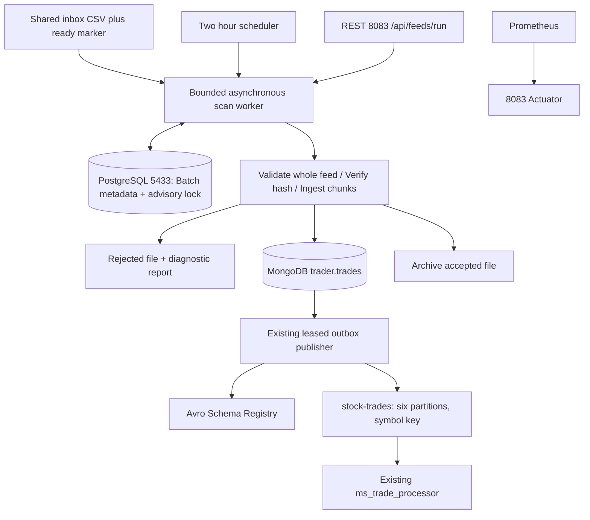

# Scheduled feed producer — HLD and LLD

Date: 2026-10-24. Accepted implementation scope: CSV defaults confirmed by the owner.
Decision: [ADR 0021](../adr/0021-scheduled-feed-producer.md). Operations and
concepts: [Spring Batch guide](../guides/SPRING_BATCH_FEED.md).

## HLD

An independent JVM in `ms_trader/feed-producer` complements the existing REST trader. It accepts huge immutable CSV
files from shared storage through a two-hour scheduled scan or REST submission. PostgreSQL owns Batch execution metadata
and scan coordination. Business trades remain in the existing MongoDB `trader.trades` collection. Both producer
applications share the same acceptance/idempotency and leased Avro publication implementation through an attached
`ms-trader:core` artifact.

Whole-feed quality rejection happens before business persistence/publication. A technical ingestion failure can leave
earlier rows accepted and published; checkpoint restart resumes that work. No XA or cross-system exactly-once guarantee
is claimed. Shared storage must provide same-filesystem atomic rename and immutable claimed files. Technical process
death with stale STARTED metadata requires operator recovery.

## LLD

| Component                                                 | Responsibility                                                                                                                      |
|-----------------------------------------------------------|-------------------------------------------------------------------------------------------------------------------------------------|
| `FeedProperties`                                          | Validate root, chunk bounds, row size and rejection policy                                                                          |
| `FeedController`                                          | Queue scans/restarts; expose request and durable execution state plus Mongo publication counts                                      |
| `FeedRunner`                                              | Single worker + one queued request; PostgreSQL session advisory lock; claim files; hash; find/restart JobInstance; file disposition |
| `FeedFiles`                                               | Stream SHA-256 using a 64 KiB buffer                                                                                                |
| `FeedCsv`                                                 | Bounded UTF-8 physical records; Commons CSV fields; shared canonical validation; byte-offset/line checkpoint                        |
| `FeedValidation`                                          | Scan complete feed in bounded tasklet iterations; counters/report; absolute and EOF percentage rejection; no TradeService calls     |
| `FeedJobConfiguration`                                    | JDBC-backed three-step job; step-scoped input and snapshotted completion policy; synchronous launcher inside asynchronous scan      |
| Shared `TradeService` / `MongoTradeRepository`            | Canonical request hash, unique row key, majority-journaled acceptance, PENDING outbox                                               |
| Shared `PublicationWorker` / `MongoPublicationRepository` | Token-fenced claims, retries, Avro publisher, ACK-before-PUBLISHED                                                                  |

### Identity and checkpoint protocol

Identifying job parameters are `feedId=SHA256(file bytes)` and `policyId`. Nonidentifying parameters snapshot the
claimed source path, report path, chunk size, maximum record bytes, count/percentage limits and correlation ID. Restarts
reuse the saved parameters. The ingestion completion policy and validation iteration size both use the saved chunk size.

`validateFeed` writes only metadata and an error-code report. Each tasklet iteration processes up to a chunk of records
and commits Batch metadata; a technical validation restart intentionally revalidates from the header and rewrites
diagnostics. Invalid header, no valid rows, absolute-limit breach, or EOF percentage breach sets `feedRejected=true`;
the job fails and the scanner moves the file into rejected storage. Invalid rows within policy are filtered during
ingestion.

`verifyImmutableFeed` compares a streaming hash with the original feed ID. It runs even when previously completed. A
mismatch is a technical failure, retaining the file for investigation and restoration, before further ingestion writes.

`ingestTrades` uses a reader ExecutionContext `{offset,line}`. For each valid physical row, it calls shared acceptance
with `feed:<hash>:row:<line>` and the scan correlation ID. A partial MongoDB chunk followed by PostgreSQL rollback
repeats the same keys on restart. This prevents duplicate durable trades despite separate transactions. Distinct content
and distinct line numbers define distinct rows, not cross-feed business identity.

### Trigger and storage boundaries

The timer uses configurable fixed delay `PT2H`, initial delay `PT30S`; both schedule and REST enqueue work before
hashing files. The worker holds PostgreSQL advisory lock 70612201 on one connection for the scan and synchronous jobs.
Another replica reports BUSY. A process-local queue permits one waiting submission; overload is 409. File names supplied
to REST must be safe CSV basenames.

Files are atomically moved from inbox into processing with a UUID prefix. Recovery scans processing files first. A
completed/rejected execution with a file still in processing is reconciled to archive/rejected on the next scan. A
technical FAILED/STOPPED execution is retried once per scan. A STARTED/STARTING execution is never stolen. One
unreadable/structurally inaccessible file can fail a scan; inspect it before the next retry.

A scan request's latest 100 states are transient. Batch history remains in PostgreSQL. A completed ingestion can still
have pending Kafka publication. GET execution reports both Batch status and independent MongoDB PENDING/PUBLISHED counts
for its content hash. Filesystem moves and Batch status are not atomic; processing reconciliation covers the normal
completion-before-move gap.

### API

| Method/path                                    | Result                                                                 |
|------------------------------------------------|------------------------------------------------------------------------|
| POST `/api/feeds/run`                          | Optional `{fileName}`; 202 queued scan, safe basename only             |
| GET `/api/feeds/requests/{id}`                 | Transient QUEUED/RUNNING/FINISHED/BUSY/FAILED request state            |
| GET `/api/feeds/executions`                    | Execution IDs from latest 50 instances                                 |
| GET `/api/feeds/executions/{id}`               | Durable Batch counts/status/rejection plus publication counts          |
| POST `/api/feeds/executions/{id}/restart`      | Queue restart; worker accepts only technical FAILED/STOPPED executions |
| GET `/v3/api-docs`, `/swagger-ui.html`         | OpenAPI and Swagger UI                                                 |
| GET `/actuator/health`, `/actuator/prometheus` | Health and metrics                                                     |

### Validation evidence

21 tests exercise bounded parsing and the real Batch job with H2 metadata and an in-memory repository. They verify
count/percentage boundaries, empty/bad-header rejection, no business persistence on rejection, persisted-partial-chunk
replay and immutable-file protection. The separate opt-in local smoke uses actual PostgreSQL/MongoDB/Kafka and checks
advisory lock contention, file readiness, rejection, publication ACK state and content deduplication. The original
trader's 104 unit/API tests pass after attaching its core artifact.
