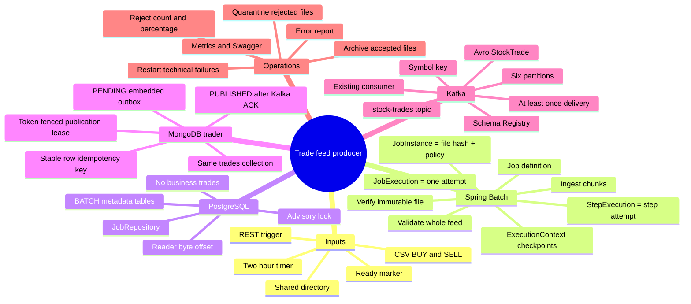
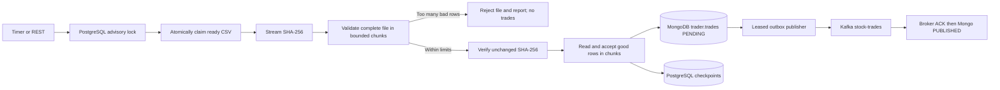

# Spring Batch + Kafka + MongoDB: your first file producer

The separate app is [ms_trader/feed-producer](../../ms_trader/feed-producer). Every two hours it scans a shared
directory for ready CSV files. You can request the same scan through REST. It validates a whole feed first, accepts its
good rows into **the existing `trader.trades` collection**, and publishes through the existing Avro/Kafka outbox code.

## Mindmap



## Follow one file



**Job** is the reusable recipe `tradeFeed`. **JobInstance** is a particular content hash and policy ID. **JobExecution**
is one attempt at that instance. A restart creates another execution of the same instance. Each execution contains
**StepExecutions** for `validateFeed`, `verifyImmutableFeed`, and `ingestTrades`.

A **chunk** is a bounded group of input records. For example, chunk size 1,000 means the ingestion reader accumulates at
most 1,000 input rows, filters the known invalid rows, calls the writer for the valid rows, and commits its PostgreSQL
checkpoint. It does **not** mean one MongoDB bulk insert, one Kafka transaction, or 1,000 parallel workers. Ingestion
currently accepts trades serially through `TradeService`.

The **ItemStreamReader** saves the next byte offset and physical line number in the step's **ExecutionContext**. A
technical ingestion restart seeks directly to the last committed offset. Validation deliberately starts from the
beginning after a validation failure; a completed validation step is skipped on an ingestion restart. The integrity step
runs again to ensure the claimed file still matches the original hash. These restart semantics
follow [Spring Batch's completed-step rules](https://docs.spring.io/spring-batch/reference/5.2/step/chunk-oriented-processing/restart.html).

## Why two databases?

| Store                   | Role                                          | Examples                                                          |
|-------------------------|-----------------------------------------------|-------------------------------------------------------------------|
| PostgreSQL `feed_batch` | Batch control and recovery                    | Job status, parameters, checkpoints, advisory scan lock           |
| MongoDB `trader`        | Business trades and durable publication state | Canonical price, trade ID, row idempotency key, PENDING/PUBLISHED |
| Kafka                   | Event transport                               | Avro records consumed by `ms_trade_processor`                     |

PostgreSQL runs as `postgres:16.6-alpine`, host port **5433**, container port **5432**, five application pool
connections, server maximum 20 connections and 32 MiB shared buffers. Compose caps it at 256 MiB for this local demo;
this is a starting configuration, not a measured production capacity claim. Its named volume preserves job history
across container restarts. JDBC URL: `jdbc:postgresql://localhost:5433/feed_batch`. MongoDB remains
`mongodb://localhost:27017/trader`.

These six Batch tables are created by Spring Boot's local schema initializer:

| Table                          | What it remembers                                    |
|--------------------------------|------------------------------------------------------|
| `BATCH_JOB_INSTANCE`           | A distinct file hash + policy job instance           |
| `BATCH_JOB_EXECUTION`          | Attempts, start/end times, status, exit information  |
| `BATCH_JOB_EXECUTION_PARAMS`   | Identity and snapshotted settings/source paths       |
| `BATCH_JOB_EXECUTION_CONTEXT`  | Feed validation counts and rejection flag            |
| `BATCH_STEP_EXECUTION`         | Per-step status, read/write/filter and commit counts |
| `BATCH_STEP_EXECUTION_CONTEXT` | Reader byte offset and line number                   |

Sequences provide IDs. Keep all metadata tables and sequences together. `BATCH_INITIALIZE_SCHEMA=always` is for this
local demo; use versioned schema migrations and `never` when managing an established deployment.

## CSV and file readiness contract

UTF-8; required header in this exact order; ISO date, BUY/SELL, integer quantity, plain decimal price:

```csv
tradeDate,side,symbol,quantity,price,currency,counterparty
2026-10-24,BUY,AAPL,10,123.450000,USD,Dealer A
2026-10-24,SELL,MSFT,5,42.25,GBP,"Dealer, B"
```

Blank currency defaults to USD; blank counterparty becomes null. The trader's existing quantity, price, symbol, side,
currency, date and counterparty rules apply. Quoted commas and doubled quotes are supported. **One record must occupy
one physical line**: embedded line breaks in quoted fields are unsupported. Blank physical lines count as invalid
records. UTF-8 BOM on the header and CRLF line endings are supported. Malformed UTF-8 and oversized records count as
invalid rows; an invalid/missing header rejects the feed.

The upstream writer must finish `inbox/orders.part`, atomically rename it to `inbox/orders.csv`, then create
`inbox/orders.csv.ready`. The scanner ignores CSVs without that marker and ignores symlink files. Once ready, the file
must remain immutable. The app atomically moves it into `processing/UUID-orders.csv` on the **same filesystem**. Shared
filesystems must support this atomic rename contract. Do not write directly into `processing` or modify its files.

The directory contains:

- `inbox`: finished CSVs and ready markers waiting to be claimed.
- `processing`: claimed files; retained after technical failures for restart.
- `archive`: successfully ingested files, including duplicate content already completed.
- `rejected`: feeds rejected by validation policy.
- `reports`: `<sha256>-<policyId>.csv`, containing `line,errorCode`, with no raw trade payloads. A validation restart
  rewrites its report.

Claimed files also have a small `.identity` sidecar preserving the original content hash and policy across automatic
retries; keep it with its file. It moves to archive/rejected with the CSV. Changing a processing file never
intentionally creates a new feed identity.

There is no automatic retention deletion. Archive/report cleanup is an operator responsibility.

## Acceptance and rejection policy

Both limits are inclusive. A feed must contain at least one valid trade.

| Setting                 | Default       | Meaning                                                                  |
|-------------------------|---------------|--------------------------------------------------------------------------|
| `FEED_DIRECTORY`        | `./var/feeds` | Shared root, resolved against app working directory                      |
| `FEED_CHUNK_SIZE`       | `1000`        | 1–10,000 input records per ingestion checkpoint and validation iteration |
| `FEED_MAX_BAD_RECORDS`  | `10`          | Allow at most this many invalid rows; zero means strict                  |
| `FEED_MAX_BAD_PERCENT`  | `100`         | Allow at most this percentage of all data rows to be invalid             |
| `FEED_MAX_RECORD_BYTES` | `65536`       | Physical record bound, 128–1,048,576 bytes                               |
| `FEED_INTERVAL`         | `PT2H`        | Fixed delay between scan submissions                                     |
| `FEED_INITIAL_DELAY`    | `PT30S`       | Delay before first automatic submission                                  |
| `FEED_SCHEDULE_ENABLED` | `true`        | Disable automatic submissions for manual-only use/tests                  |
| `FEED_POLICY_ID`        | `v1`          | Change deliberately to reevaluate previously rejected content            |

With maximum bad count 10, ten bad rows are allowed, eleven reject the feed. The absolute limit can stop validation
early once exceeded. Percentage is evaluated at EOF, because later good records may lower the percentage. Either
exceeded limit rejects the **whole feed before MongoDB trade persistence or Kafka publication**. A diagnostic report and
Batch metadata are still written. A header-only feed and an all-invalid feed reject even if the count/percentage would
otherwise permit them.

A technical failure after ingestion starts has different semantics: earlier accepted trades may already have published.
It is restartable; it is not a whole-feed rollback. If you need all-or-nothing business visibility for technically
interrupted ingestion, add durable staging and an explicit release protocol.

## Build and run

Use Java 21. From the platform root, install schema and trader core before building the separate application:

```sh
mvn -f schemas/pom.xml install
mvn -f ms_trader/pom.xml install
mvn -f ms_trader/feed-producer/pom.xml verify
cd infra
python3 scripts/init-monitoring-env.py
docker compose up -d
cd ../ms_trader/feed-producer
java -Xms64m -Xmx192m -jar target/feed-producer-0.0.1-SNAPSHOT.jar
```

The password helper adds only missing passwords to ignored `infra/.env`, without printing or replacing them. The app
imports that file using its documented working directory. Override its location with `FEED_SECRETS_FILE` or supply
`FEED_POSTGRES_PASSWORD` directly. Do not put passwords in JDBC URLs or commit the `.env` file. PostgreSQL
initialization credentials only apply to a **fresh** data volume; changing `.env` alone does not rotate an existing
database password.

Other overrides: `FEED_JDBC_URL`, `FEED_POSTGRES_USER`, Compose `FEED_POSTGRES_PORT` (also update JDBC URL if changed),
`MONGODB_URI`, `KAFKA_BOOTSTRAP_SERVERS`, `SCHEMA_REGISTRY_URL`, `SERVER_PORT`, `PUBLICATION_ENABLED`. The trader
application can remain running. Both publishers use the same MongoDB token-fenced claims; a Kafka ACK/Mongo update crash
window can still produce duplicate physical events.

## Trigger and inspect

Swagger: [http://localhost:8083/swagger-ui.html](http://localhost:8083/swagger-ui.html). OpenAPI: `/v3/api-docs`.

```sh
# From ms_trader/feed-producer, create a finished sample.
mkdir -p var/feeds/inbox
printf 'tradeDate,side,symbol,quantity,price,currency,counterparty\n2026-10-24,BUY,AAPL,10,123.45,USD,Demo\n' > var/feeds/inbox/orders.part
mv var/feeds/inbox/orders.part var/feeds/inbox/orders.csv
touch var/feeds/inbox/orders.csv.ready
curl -s -X POST http://localhost:8083/api/feeds/run -H 'Content-Type: application/json' -d '{"fileName":"orders.csv"}'
# Omit fileName or send {} to scan every ready CSV.
curl -s http://localhost:8083/api/feeds/requests/REQUEST_ID
curl -s http://localhost:8083/api/feeds/executions
curl -s http://localhost:8083/api/feeds/executions/EXECUTION_ID
curl -s -X POST http://localhost:8083/api/feeds/executions/EXECUTION_ID/restart
```

202 means the scan is queued, not that the feed is accepted. One worker and one queued submission are allowed; further
requests receive 409. Scans across instances compete for a PostgreSQL session advisory lock; a losing request reports
`BUSY`. Schedule submissions use the same path. Restart eligibility is checked by the asynchronous worker; an ineligible
request reports `FAILED`.

Request states are in-memory, retain only the latest 100 requests, and disappear on restart. **Execution IDs and states
are durable in PostgreSQL.** A request `FINISHED` means its scan finished; inspect each execution for `COMPLETED` or
`FAILED`, the `rejected` flag, and counts. `COMPLETED` means trades were durably accepted into MongoDB. Check
`publication.pending` and `publication.published` separately for broker-acknowledged delivery. Those counts cover the
content hash across policy versions. Two MongoDB count queries can observe slightly different instants during active
publication.

Inspect job tables from `infra` without exposing credentials:

```sh
docker compose exec feed-postgres psql -U feed_batch -d feed_batch -c 'select job_execution_id,status,start_time,end_time from batch_job_execution order by job_execution_id desc limit 10;'
docker compose exec feed-postgres psql -U feed_batch -d feed_batch -c 'select step_name,status,read_count,write_count,filter_count,commit_count from batch_step_execution order by step_execution_id desc limit 20;'
```

Inspect events in [Kafdrop](http://localhost:9000) under `stock-trades`. Inspect the feed app at `/actuator/health` and
`/actuator/prometheus`; Prometheus includes a scrape target on port 8083. The shared producer metrics describe
acceptance and publication. PostgreSQL execution history is the feed-level operational source.

## Restart, identity, and huge-file trade-offs

A row key is `feed:<sha256>:row:<physical-line-number>`. Same bytes submitted under another filename use the same
JobInstance and create no new trades. Distinct physical rows containing identical trades **are separate trades**.
Different content (even changed whitespace) has a new hash; overlapping trades across distinct feeds are not
business-deduplicated. Add an upstream trade ID if cross-feed business deduplication is required.

PostgreSQL chunk commits and MongoDB inserts are not one transaction. If MongoDB persists part of a chunk and the
process fails before its PostgreSQL checkpoint, restart repeats those row keys; MongoDB's unique idempotency index
resolves the replay. Kafka publication is at least once; the existing consumer deduplicates by trade ID.

A scan retries technical FAILED/STOPPED processing files once per scan, with their original saved parameters. You can
request an earlier restart through REST. Rejected feeds cannot use technical restart; fix their data or deliberately
change `FEED_POLICY_ID` and resubmit the CSV through inbox (do not copy its old `.identity` sidecar). Completed jobs
cannot restart. Changing policy does not change row idempotency keys.

A hard process death may leave Batch metadata `STARTED`/`STARTING`. The scanner deliberately does not steal that
execution. First prove that no worker still owns it, preserve the original file, then use an operator-controlled Batch
metadata recovery procedure to mark it failed before restart. Automatic stale-job takeover is not implemented. Do not
delete the job tables to recover one file.

Memory grows with chunk size and record bound, not file size. However, a successful feed requires three full sequential
passes (hash, validation, integrity rehash) followed by ingestion; a technical ingestion restart rehashes the file and
seeks to its last committed ingestion offset. Validation restarts from the beginning. This spends disk I/O to guarantee
rejection before business writes without storing an entire feed in memory. There is no parallel partitioning of a single
file yet. Choose smaller chunks for lower memory/checkpoint replay cost, larger chunks to reduce PostgreSQL checkpoint
overhead; benchmark using representative feeds before sizing.

## Verification and interview explanations

`mvn verify` runs 21 reader/parser and real Spring Batch job tests using H2 metadata and an in-memory trade repository.
They cover inclusive rejection limits, EOF percentage rules, empty/bad-header feeds, zero persistence on rejection,
partial-chunk replay, and changed-source protection. They do not claim PostgreSQL/Mongo/Kafka coverage by themselves.

For the opt-in real-stack smoke, start the app with
`FEED_SCHEDULE_ENABLED=false FEED_CHUNK_SIZE=2 FEED_MAX_BAD_RECORDS=1` and default 100% allowance, then run
`python3 scripts/smoke.py` from its directory. It checks path rejection, ready-marker gating, the actual PostgreSQL
advisory lock, rejected-feed zero persistence, two MongoDB trades reaching PUBLISHED after Kafka ACK, and
duplicate-content deduplication. It deliberately retains tagged demo trades and archived files as evidence.

Useful interview answers:

- **Why Spring Batch rather than only `@Scheduled`?** Scheduling starts work; Batch supplies durable attempts, step
  history, checkpoints, and restart semantics.
- **Why PostgreSQL when trades live in MongoDB?** The JDBC JobRepository manages Batch coordination independently of
  business persistence.
- **Does chunk commit make Kafka and MongoDB atomic?** No. Stable idempotency keys plus a durable outbox handle the
  separate commit boundaries.
- **Why validate twice/read multiple times?** Whole-feed validation prevents a late bad row from rejecting a feed whose
  earlier trades already escaped.
- **Does COMPLETED mean every consumer processed it?** It means the ingestion job completed. MongoDB publication counts
  show broker ACKs; consumer processing is another independently observable stage.
- **What breaks exactly-once claims?** MongoDB persistence, PostgreSQL checkpoints, Kafka ACKs, and filesystem moves
  have independent failure windows.
